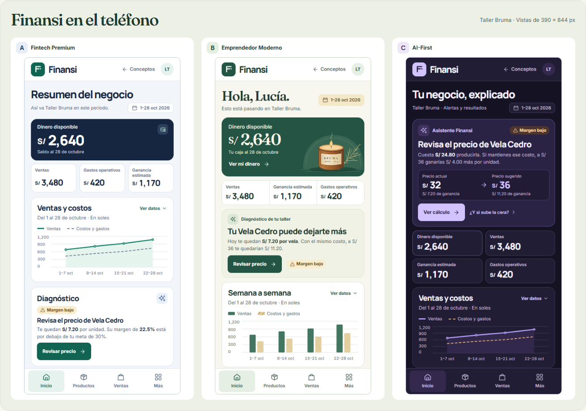

# Finansi

Finansi ayuda a personas que fabrican y venden en lotes pequeños a calcular su costo, decidir cuánto cobrar y distinguir ganancia de dinero disponible. La Fase 1 presenta investigación y tres propuestas visuales para el dashboard; la dirección visual sigue pendiente de aprobación.

[Galería HTML](docs/design/prototipo/index.html) · [Comparación y recomendación](docs/design/02-conceptos.md)

Para recorrer las maquetas, clona o descarga el repositorio y abre **docs/design/prototipo/index.html** en el navegador. No necesita instalar dependencias ni conexión. Los enlaces del dashboard llevan a datos de ejemplo; la galería permite ver las seis imágenes a tamaño original.

| Propuesta | Escritorio · 1440 × 900 | Móvil · 390 × 844 |
| --- | --- | --- |
| A · Fintech Premium | [Ver PNG](docs/design/mockups/a-escritorio.png) | [Ver PNG](docs/design/mockups/a-movil.png) |
| B · Emprendedor Moderno | [Ver PNG](docs/design/mockups/b-escritorio.png) | [Ver PNG](docs/design/mockups/b-movil.png) |
| C · AI-First | [Ver PNG](docs/design/mockups/c-escritorio.png) | [Ver PNG](docs/design/mockups/c-movil.png) |

## Investigación y diseño

- [Mercado peruano y siete plataformas comparadas](docs/research/01-mercado-y-competencia.md).
- [Referencias de UX, interfaz y accesibilidad](docs/research/02-ux-ui.md).
- [Diferenciación, recomendación de MVP y demo de tres minutos](docs/research/03-diferenciacion-y-mvp.md).
- [Arquitectura, flujos y adaptación por dispositivo](docs/design/01-arquitectura-y-flujos.md).
- [Sistema visual provisional](docs/design/03-sistema-de-diseno.md) y [datos de Taller Bruma](docs/design/04-caso-demo.md).

**Decisión pendiente:** se recomienda B por su foco en la caja y la próxima decisión del taller. La aprobación de un concepto permite diseñar los demás mockups. La aplicación funcional requiere autorización independiente.

Las fuentes locales de la galería (Inter, Manrope y Fraunces) se distribuyen con sus [licencias](docs/design/prototipo/fonts/). El logotipo y la ilustración de Taller Bruma se crearon para estas maquetas.
