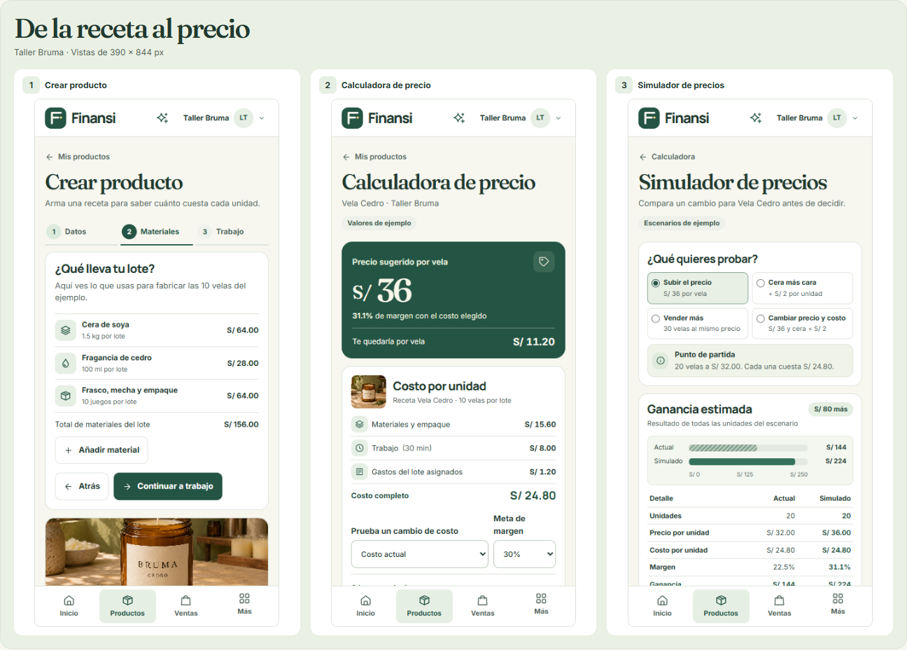

# Finansi

Finansi ayuda a quienes fabrican en lotes pequeños a calcular cuánto cuesta producir, decidir cuánto cobrar y distinguir la ganancia del dinero disponible. El diseño de la Fase 1 aplica el concepto aprobado **B · Emprendedor Moderno** a 12 pantallas.

[Empezar en Bienvenida](docs/design/finansi/index.html) · [Galería navegable](docs/design/finansi/pantallas.html) · [Índice de las 24 capturas](docs/design/05-prototipo-b.md)

Abre **index.html** desde la raíz del repositorio. La misma entrada sirve para publicar la demo como sitio estático y para recorrerla sin conexión. Usa el caso ficticio de Taller Bruma para probar el alta de producto, los escenarios de precio, el registro de ventas y la caja.

## Investigación y diseño

- [Mercado peruano y siete plataformas comparadas](docs/research/01-mercado-y-competencia.md).
- [Referencias de UX, interfaz y accesibilidad](docs/research/02-ux-ui.md).
- [Diferenciación, alcance del MVP y demo de tres minutos](docs/research/03-diferenciacion-y-mvp.md).
- [Arquitectura, flujos y adaptación por dispositivo](docs/design/01-arquitectura-y-flujos.md).
- [Sistema visual](docs/design/03-sistema-de-diseno.md) y [datos de Taller Bruma](docs/design/04-caso-demo.md).
- [Exploración inicial de conceptos A, B y C](docs/design/02-conceptos.md).

Las fuentes locales Inter, Manrope y Fraunces se distribuyen con sus [licencias](docs/design/prototipo/fonts/).
